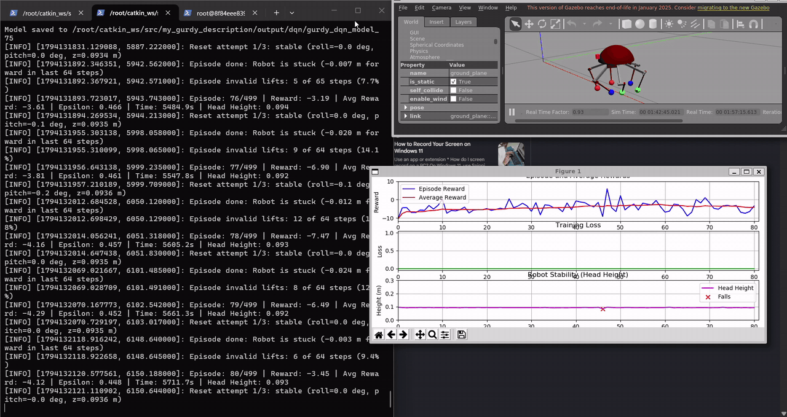
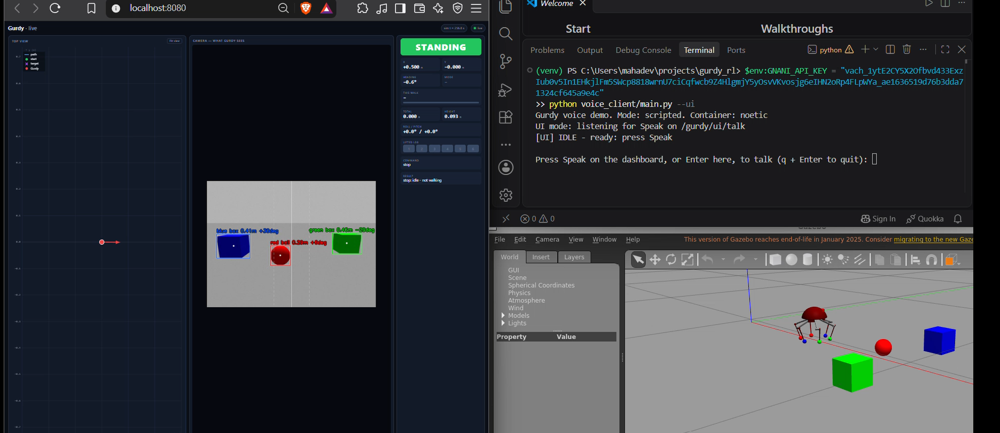
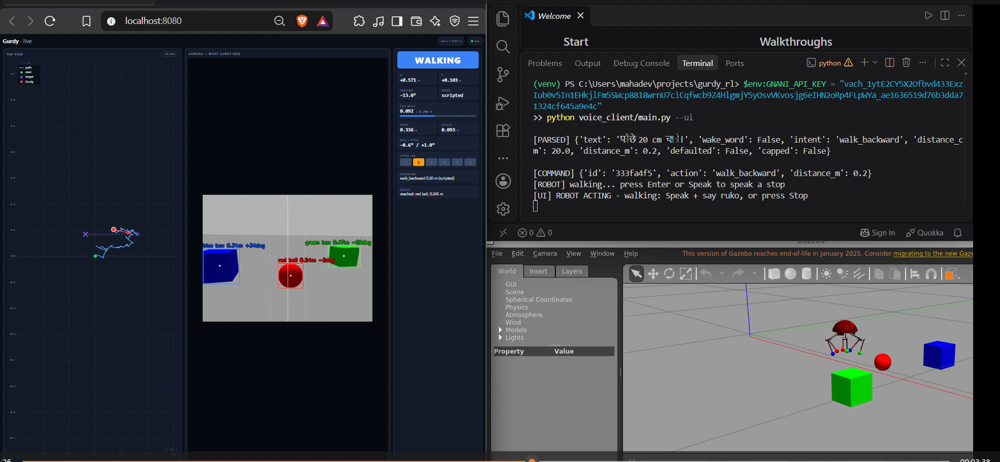
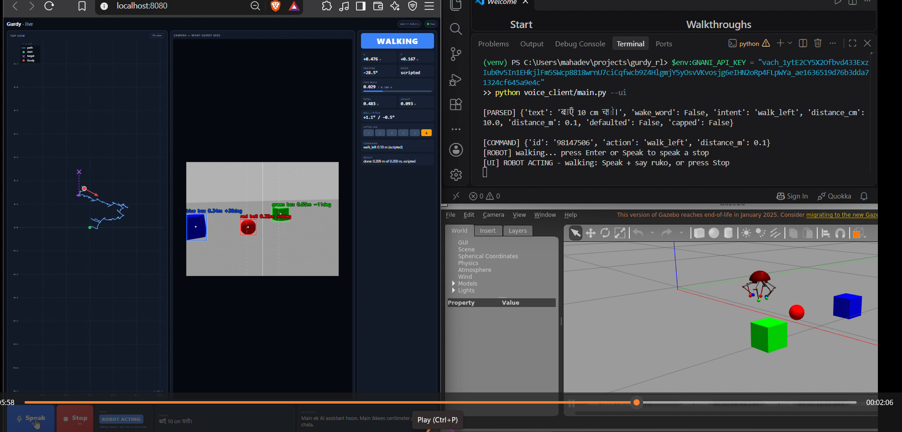
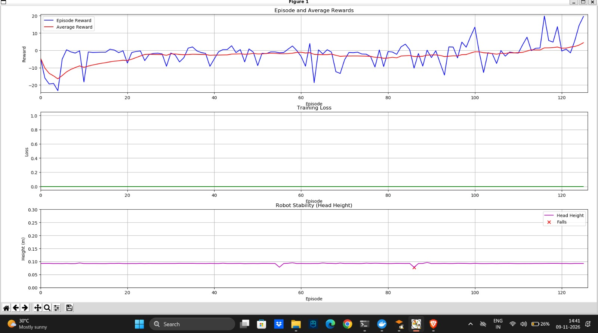
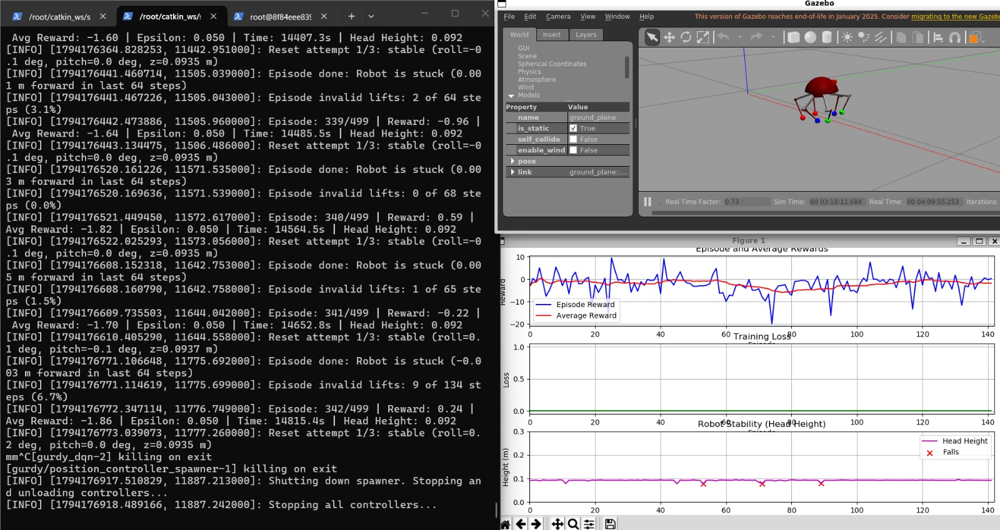
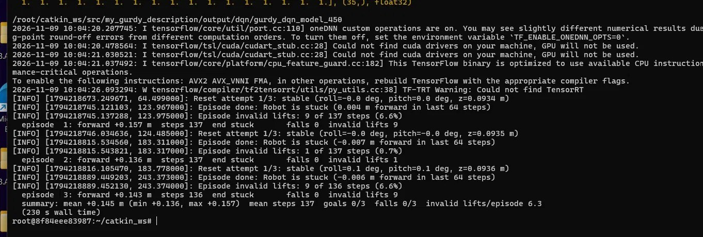

# 🕷️ Gurdy: Voice-Controlled Hexapod Robot in Hindi

**Speak in Hindi → Gurdy sees, walks and talks back.**
A six-legged robot in ROS + Gazebo, controlled by voice in Hindi/Hinglish using **Gnani AI** speech models, with **OpenCV** vision and a walking controller trained with **reinforcement learning (DQN)**.

🎥 **Watch the full demo video:** [Google Drive](https://drive.google.com/file/d/1QdSBvXtVi8ORKgecSzXtB5uT-qSGm45h/view?usp=sharing)

[](https://drive.google.com/file/d/1QdSBvXtVi8ORKgecSzXtB5uT-qSGm45h/view?usp=sharing)



---

## ✨ What it can do

| You say (Hindi) | Gurdy does |
|---|---|
| **क्या दिख रहा है?** _(kya dikh raha hai?)_ | Describes what its camera sees: *"saamne laal gend, baayen neela dabba…"* |
| **लाल गेंद के पास जाओ** _(laal gend ke paas jao)_ | Walks to the red ball using the camera (also blue/green boxes) |
| **आगे / पीछे 20 cm चलो** _(aage / peeche…)_ | Walks forward / backward |
| **बाएँ / दाएँ 10 cm चलो** _(baayen / daayen…)_ | Walks sideways left / right |
| **RL mode** / **normal mode** | Switches forward walking between the trained DQN and the scripted gait |
| **रुको** _(ruko)_ or the **Stop** button | Stops immediately |
| **कितना चला?** _(kitna chala?)_ | Reports the total distance walked |

Every reply is spoken back in Hinglish and starts with **"Main ek AI assistant hoon"**, so users always know they are talking to an AI.

| Walking backward | Walking left (sideways) |
|---|---|
|  |  |

---

## 🧠 How it works

```
 🎤 Voice (Hindi)
   └─► Gnani Prisma v3.0 (speech-to-text) ──► "आगे 20 cm चलो"
          └─► Keyword parser ──► {"action": "walk_forward", "distance_m": 0.2, "mode": "rl"}
                 └─► ROS node (in Docker) ──► scripted gait  OR  trained DQN (with fallback)
                        │                     + OpenCV vision for "go to object"
                        └─► Gurdy moves in Gazebo
   🔊 Gnani Timbre v2.5 (text-to-speech) ◄── "Main ek AI assistant hoon. Main bees centimeter aage chala."
   🖥️ Web dashboard (localhost:8080): map, live camera, status, Speak / Stop buttons
```

### Models and components

| Part | Model / tool | Made by |
|---|---|---|
| Speech-to-text | **Gnani Prisma v3.0** (`api.vachana.ai`) | Gnani AI |
| Text-to-speech | **Gnani Timbre v2.5**, voice *Poorvi* (`hi-en`) | Gnani AI |
| Command understanding | Keyword parser (Devanagari + romanized Hindi) | this project |
| Walking (RL mode) | **DQN**, trained 450 episodes in Gazebo | this project |
| Walking (normal mode) | Scripted gaits: forward, backward, left, right | this project |
| Vision | **OpenCV** HSV colour detection | this project |
| Simulation | ROS Noetic + Gazebo 11 (Docker on Windows/WSL) | — |

### The robot (xacro)
- Body (`head_link`, 0.3 kg) with **6 legs** defined once as a xacro macro.
- Each leg: **hip** + **knee** revolute joints, each driven by an effort-based **PID position controller** (`ros_control`).
- Sensors: ground-truth odometry, IMU, and a **forward-facing head camera** (800×600, tilted 12° down).
- Foot positions are converted to joint angles with a small **inverse-kinematics** solver.

### Reinforcement learning (DQN)
- **Input (35 values):** each leg's pose, forward speed, forward distance, body height, last action, time in episode.
- **Output (25 actions):** for each of 6 legs: LIFT / LOWER / REACH_IN / REACH_OUT, plus STAND.
- **Reward:** + forward progress, small + for staying upright, − for falling, − for invalid moves.
- **Safety:** at most one leg lifted at a time; in the demo the system **falls back to the scripted gait** if RL stalls.





**Evaluation of checkpoint 450 (greedy, no exploration):**



| Metric | Result |
|---|---|
| Mean forward distance | **14.5 cm** (13.6 – 15.7 cm) |
| Falls | **0 / 3** |
| Speed on short walks | ~1.5 mm/step, same as the scripted gait |

### Vision (OpenCV)
Camera image → HSV colour thresholds → contours → for each object: **direction** (bearing), **rough distance** (size) and **shape** (ball/box).
*Go to object* is closed-loop: side-step until the object is centred, walk forward, stop when it is close.

### Measured gait performance (scripted)

| Direction | Distance | Steps | Falls |
|---|---|---|---|
| Forward | 0.546 m | 320 | 0 |
| Backward | 0.583 m | 320 | 0 |
| Left | 0.259 m | 240 | 0 |
| Right | 0.292 m | 240 | 0 |

---

## 🚀 Setup (Windows, no dual boot)

### Requirements
- Windows 10/11 with **WSL 2** (Ubuntu) and **Docker Desktop** (WSL integration enabled for Ubuntu)
- Python 3.10+ on Windows (for the voice client) and a microphone
- A **Gnani AI API key** (from the Gnani API dashboard)

### 1. Clone the code (inside WSL Ubuntu)
```bash
mkdir -p ~/catkin_ws/src && cd ~/catkin_ws/src
git clone https://github.com/mrsssok2/gurdy_rl.git my_gurdy_description
```

### 2. Create the ROS Noetic container (one time)
```bash
docker run -it --name noetic -p 8080:8080 \
  -v ~/catkin_ws:/root/catkin_ws \
  -v /tmp/.X11-unix:/tmp/.X11-unix -v /mnt/wslg:/mnt/wslg \
  -e DISPLAY=$DISPLAY -e WAYLAND_DISPLAY=$WAYLAND_DISPLAY -e XDG_RUNTIME_DIR=$XDG_RUNTIME_DIR \
  osrf/ros:noetic-desktop-full bash
```
Inside the container:
```bash
apt update && apt install -y ros-noetic-gazebo-ros-control ros-noetic-ros-controllers \
    python3-pip python3-tk python-is-python3 fonts-lohit-deva
pip3 install "gym==0.21.0" "tensorflow==2.13.*" "numpy==1.24.3" pyquaternion
pip3 install -r ~/catkin_ws/src/my_gurdy_description/requirements-web.txt
echo "source /opt/ros/noetic/setup.bash" >> ~/.bashrc && source ~/.bashrc
cd ~/catkin_ws && catkin_make
```

### 3. Voice client (Windows PowerShell, repo root)
```powershell
python -m venv venv
.\venv\Scripts\Activate.ps1
pip install -r voice_client/requirements.txt
```

---

## ▶️ Running the demo

Start **Docker Desktop** first (wait for *Engine running*).
Every container terminal starts with:
```powershell
wsl -d Ubuntu
```
```bash
docker start noetic          # only needed once after a reboot
docker exec -it noetic bash  # prompt must change to root@...
cd ~/catkin_ws && source devel/setup.bash
```

**Terminal 1: Gazebo with the demo world (robot + red ball + blue/green boxes)**
```bash
roslaunch my_gurdy_description one_touch_spawn_control.launch world:=demo
```

**Terminal 2: voice + vision node (with the trained RL model)**
```bash
roslaunch my_gurdy_description voice_demo.launch \
  rl_model_path:=/root/catkin_ws/src/my_gurdy_description/output/dqn/gurdy_dqn_model_450
```
> The trained checkpoint is not in the repository: `output/dqn/` is created by training (see *Training the RL model* below). Without it, leave out `rl_model_path`; RL mode then falls back to the scripted gait.

**Terminal 3: web dashboard**
```bash
rosrun my_gurdy_description web_dashboard.py
```
Open **http://localhost:8080** in your browser.

**Windows PowerShell: voice client**
```powershell
.\venv\Scripts\Activate.ps1
$env:GNANI_API_KEY = "<your Gnani API key>"
python voice_client/main.py --ui
```
Click **Speak** on the dashboard (or press **Space**) and talk. **Stop** (or **Esc**) stops the robot.

> Never commit your API key. It is read only from the `GNANI_API_KEY` environment variable.

---

## 🏋️ Training the RL model

Gazebo in the **empty** world (Terminal 1):
```bash
roslaunch my_gurdy_description one_touch_spawn_control.launch
```
Train (Terminal 2):
```bash
roslaunch my_gurdy_description launch_dqn.launch                 # full run
roslaunch my_gurdy_description launch_dqn.launch smoke_test:=true # 5-episode check
```
Checkpoints are saved every 25 episodes in `output/dqn/`. To resume, set `load_model_path` in `config/params_dqn.yaml`, e.g. `"output/dqn/gurdy_dqn_model_325"`.

Evaluate checkpoints (needs `start_controllers.launch` running):
```bash
rosrun my_gurdy_description evaluate.py output/dqn/gurdy_dqn_model_450 --episodes 3
rosrun my_gurdy_description evaluate.py --all     # rank every checkpoint
```

Test the scripted gaits:
```bash
rosrun my_gurdy_description test_gait.py 20 --wave-all            # forward
rosrun my_gurdy_description test_gait.py 20 --wave-all --mirror   # backward
rosrun my_gurdy_description test_gait.py 10 --left                # left
rosrun my_gurdy_description test_gait.py 10 --right               # right
```

---

## ⚠️ Limitations (honest)
- **Simulation only**, not yet on real hardware.
- Gurdy's legs push only along radial "spokes", so it **cannot turn**; sideways and backward walks drift a few degrees.
- On flat ground the **scripted gait is still stronger** than RL (RL stalls after ~15 cm).
- Commands are keyword-based; misheard words (e.g. *baayen*) may need repeating.

## 🔭 Next steps
- Train RL on **slopes, rough or slippery ground** and with a **damaged leg**, where fixed gaits fail.
- An RL **navigator** that chooses gait strokes to reach a target and correct drift.
- More languages (Kannada, Tamil…) and port to a real hexapod.

## 🌍 Real-world use
Voice control in Indian languages for field robots: agriculture, inspection, search and rescue, and assistive devices, so people can command robots naturally without English software.

---

📘 Developer notes (all launch options, tuning, internals): [docs/DEVELOPER_NOTES.md](docs/DEVELOPER_NOTES.md)

**Tech:** ROS Noetic · Gazebo 11 · Docker · WSL 2 · Python · TensorFlow/Keras (DQN) · OpenCV · Flask · Gnani AI Prisma & Timbre
